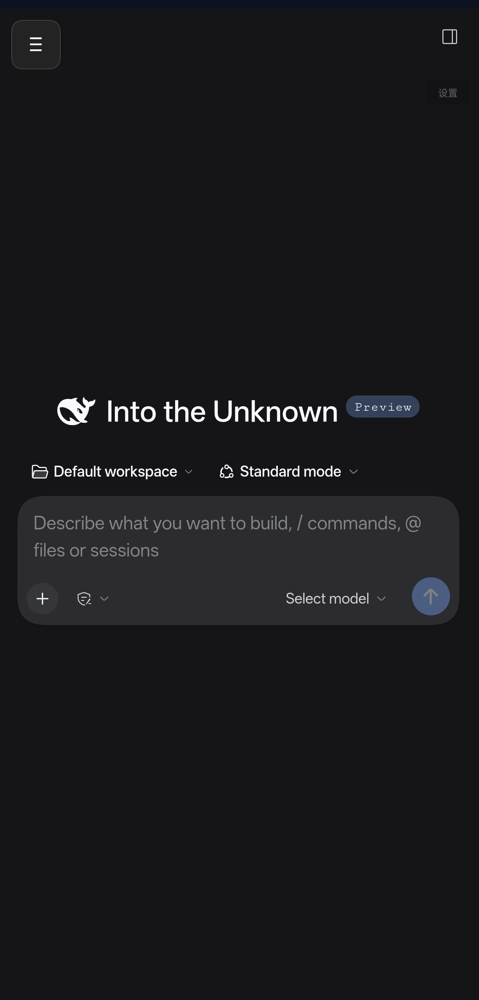

# 局域网控制 DSH

[](https://github.com/Asxdct6/dsh-lan-control/actions/workflows/build-apk.yml)

在手机上通过局域网控制电脑上运行的 [DeepSeek Harness](https://github.com/deepseek-ai/DeepSeek-Harness)（DSH）。

一个极薄的 Android WebView 壳：把 DSH 的 Web UI 装进原生应用，配上移动端抽屉导航、自适应图标和崩溃自诊断。



> 这个 App **不包含** DSH 本体。DSH 仍然跑在你的电脑上，手机只是通过 Wi-Fi 访问它。

## 它解决什么

DSH 的 Web UI 在桌面浏览器里很好用，但在手机上有三个现实问题：

1. 浏览器地址栏、标签页吃掉本来就窄的屏幕
2. 每次连都要手敲 `http://ip:port/?token=...`
3. 手机浏览器切后台后页面容易被回收

这个壳把这三点收掉了：全屏、地址内置、原生 Activity 保活。

## 功能

| 功能 | 说明 |
|---|---|
| 全屏 WebView | 无地址栏，页面即应用 |
| 移动端布局 | 依赖 DSH 插件 `dsh-mobile-shell`（App 风格抽屉、移动端设置页、Android 返回栈） |
| 地址管理 | 连接配置持久化；连不上时在错误页直接改地址 |
| 返回键 | 优先走 WebView 历史，退到底再退出应用 |
| 断连提示 | 连不上时显示错误页，可重试或改地址 |
| 崩溃自诊断 | 未捕获异常落盘，下次启动弹窗展示堆栈，可一键复制 |
| 自适应图标 | Android 8.0+ Adaptive Icon，5 档密度 |

## 环境要求

- 电脑：DSH 已安装，且与手机在**同一个 Wi-Fi / 局域网**
- 手机：Android 7.0+（`minSdk 24`）
- 构建：JDK 17、Android SDK（`platform-34`、`build-tools 34.0.0`）

## 快速开始

### 1. 在电脑上把 DSH 暴露到局域网

```powershell
.\start-dsh-lan.ps1
```

脚本会自动挑一个局域网 IPv4 并启动 `dsh web`，然后打印形如：

```
http://192.168.1.100:8787/?token=xxxxxxxx
```

`--host` 只接受具体 IPv4、不能用 `0.0.0.0`（DSH 的设计），所以脚本会帮你探测。

### 2. 构建 APK

```powershell
.\build_debug.ps1 -DshUrl "http://192.168.1.100:8787/?token=xxxxxxxx"
```

不带 `-DshUrl` 也行，APK 里会烧一个占位地址，首次启动时弹框让你填。

产物：`app/build/outputs/apk/debug/app-debug.apk`

### 3. 安装

```powershell
adb install -r app\build\outputs\apk\debug\app-debug.apk
```

或者把 APK 拷到手机上点安装（debug 签名，需要允许「未知来源」）。

### 4. 首次打开

- 构建时烧了真实地址 → 直接进 DSH
- 构建时是占位地址 → 弹出「连接设置」，粘贴第 1 步打印的完整地址（**要带 `?token=`**）

## 关于 token

DSH 在非回环地址上启动时会生成一次性 token，**每次重启服务都会变**。
变了之后 App 会显示「无法连接到 DSH」，在错误页点「改地址」粘贴新地址即可。

这是 DSH 的安全设计，不是 App 的缺陷。

## 目录结构

```
app/src/main/java/com/dsh/lancontrol/
  MainActivity.kt      WebView 宿主、返回键、错误页、地址设置
  CrashLogger.kt       崩溃落盘与下次启动回显
  App.kt               注册全局崩溃处理器
app/src/main/res/
  values/strings.xml               应用名与文案
  mipmap-*/                        5 档图标 + anydpi-v26 自适应图标
  xml/network_security_config.xml  放行局域网明文 HTTP
tools/
  make_app_icon.py     生成图标源图（显示器 + >_ + 信号弧）
  make_icons.py        生成各密度与自适应图标
  apply_icon.ps1       一键换图标
build_debug.ps1        一键编译
start-dsh-lan.ps1      在局域网 IP 上启动 DSH Web
```

## 实现要点

- **不开 `useWideViewPort`**：开了会让页面按桌面 980px 排版再整体缩放，字会小到看不清，且移动端插件的断点失效
- **`adjustResize`**：键盘弹出时页面整体上移，输入框不被遮挡
- **不使用任何第三方依赖**：只用 Android 平台 API，构建快、体积小（APK ≈ 0.95 MB）
- **放行明文 HTTP**：局域网是 `http://`，通过 `network_security_config` 显式声明
- **同主机不同端口不算外部链接**：否则跳板地址的 302 会被甩给系统浏览器

## 远程访问（可选）

想在外面也能连，又不想把端口开到公网，可以用 Tailscale 做一条私有通道：

```powershell
# 1. 电脑装 Tailscale 并登录，拿到 100.x.y.z 和 MagicDNS 名
# 2. DSH 只绑回环
dsh web --host 127.0.0.1 --port 8787 --no-open `
    --trusted-host <机器>.<tailnet>.ts.net `
    --public-url https://<机器>.<tailnet>.ts.net:8443/

# 3. 用 tailscale serve 暴露给 tailnet（后台管理后台开启 HTTPS Certificates）
tailscale serve --bg --https=8443 http://127.0.0.1:8787
```

这样 DSH 不会出现在局域网里，只有 tailnet 内设备能访问，且带真实证书。

**token 轮换怎么办？** DSH 每次启动都会换 token，地址一改 App 就失联。
可以加一个几十行的本地跳板：监听 `127.0.0.1:8081`，每次请求都 `302` 到
`https://<host>:8443/?token=<当前 token>`，token 由守护进程从 DSH 输出里实时抓取并写文件。
再用 `tailscale serve --bg --https=443 http://127.0.0.1:8081` 暴露跳板，
App 里填 `https://<机器>.<tailnet>.ts.net/` 即可——**地址永久固定**。

### 让手机连到 Electron 桌面实例

如果你用的是 DSH 桌面客户端，又想让手机连**同一个实例**（而不是另起一个 `dsh web`），
情况会麻烦一点：桌面实例的鉴权是绑定端口的签名 cookie，token 不落盘也不在渲染进程里。

`tools/electron-bridge/` 里有一套现成的解法（抓 cookie + 反代 + 自愈守护），
原理和详细步骤见 [docs/electron-bridge.md](docs/electron-bridge.md)。

> 注意：这套方案要求客户端带 `--remote-debugging-port=9222 --inspect=9229` 启动，
> 且依赖 DSH 内部实现，升级后可能失效。
>
> 另外，`dsh-mobile-shell@0.7.6` 的激活断点写的是 `max-width: 10230px`（等于全尺寸生效），
> 装进桌面 profile 时要把 `lib/client.js` 里的 `10230px` 改成 `1023px`，否则桌面端也会变成移动布局。

## 已知限制

- 纯壳，DSH 必须单独运行
- 依赖局域网直连；公网访问需要自建隧道，且 DSH 的 host 校验会拦
- debug 签名，不适合分发
- 仅在 Android 17（API 37）/ OPPO PLG110 上实测过

## License

[MIT](LICENSE)
